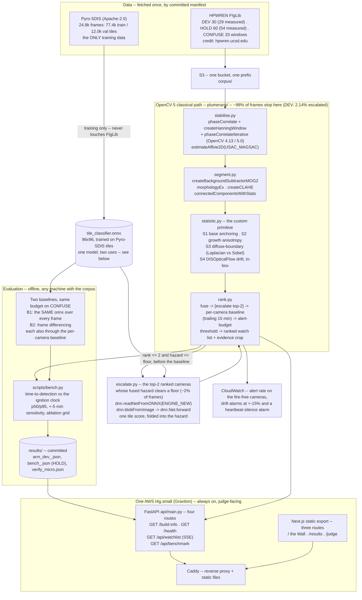

# Architecture

One diagram, four routes, one box. See [`README.md`](README.md) for what the system does and
why; this page is how it is built.

## The one model, two uses

`tile_classifier.onnx` is the **only** trained component. It is run through
`dnn.readNetFromONNX(ENGINE_NEW)` in two different places with two different jobs:

1. **`escalate.py`** -- scores the camera-frames ranked in the top 2 whose fused hazard clears
   `ESCALATION_HAZARD_MIN` (~2% of frames), and that score is folded into the fused hazard
   before the per-camera baseline.
2. **Baseline B1** -- the *identical* model, run over a full-frame tile grid on **every** frame.

Because the model is the same on both sides, a difference between PlumeRank and B1 cannot be
explained by model size. The like-for-like rows go one step further: B1 and B2 are also scored
through the same per-camera baseline PlumeRank uses, and on DEV that baseline does most of the
work (B1 rises from 6/29 to 14/29 through it, against PlumeRank's 17/29). What remains between
PlumeRank and B1-through-the-baseline is the classical pipeline plus targeted escalation versus a
full-frame CNN at every frame -- at 1.4 model calls per camera-window on the held-out run (1.7 on DEV) instead of 3,645.

## Data flow, in order

**Offline, once** -- `scripts/fetch.py` pulls the corpus named by a committed, sha256-pinned
manifest (never the full archive) into `data/` and `s3://<bucket>/corpus/`.
`scripts/build_confusion_set.py` builds a non-fire confusion set from the same cameras at the
same time of day. `scripts/train_tile_classifier.py` trains the one ONNX model on Pyro-SDIS
**only** (a guard test asserts no FIgLib path ever enters the training manifest). `scripts/bench.py`
runs every arm: the DEV arm writes `results/arm_dev_<date>.json`, and the one held-out run
writes `results/bench_<date>.json`, which `GET /api/benchmark` then serves byte-for-byte.

**Online, per replay tick** -- stabilise against the previous raw frame (not a fixed reference; a whole-frame
phase correlation, so under moving cloud the estimate follows the sky -- refereed against the
ground in `results/registration_2026-10-10.json`), segment, measure S1-S4,
fuse into a hazard, escalate -- within each arm -- the top-2 ranked cameras whose hazard clears
the escalation floor through the ONNX tile classifier (the wall is the DEV and CONFUSE replays on
one screen and reads each camera's arm from the manifest, as bench.py escalates each arm
separately; a single-roster deployment would allot two slots in total), rebase each hazard against the camera's own trailing 15
minutes, compare it with the committed threshold (solved offline on the confusion set), emit
the ranked list with one evidence crop per entry (drawn server-side with `cv2.line` /
`cv2.rectangle` / `cv2.putText`, written with `cv2.imwrite`), and stream it over SSE.

**There is no pre-rendered ranking anywhere on the judged path.** The background model warms
from the pre-ignition frames FIgLib supplies, on screen -- exactly what a real camera start
looks like. `GET /api/benchmark` serves the committed held-out file (`results/bench_2026-10-10.json`)
verbatim, and the live Wall runs on its threshold -- solved on the fire-free confusion set, the
only arm the threshold depends on -- and says so on screen. `bench.py` refuses to
publish any threshold it could not calibrate to the budget (`_check_calibration`).

## API endpoints -- four, all GET

| Path | Returns |
|---|---|
| `GET /build-info` | `cv2.getBuildInformation()` verbatim, `cv2.__version__`, a module-availability probe, the instance id and AMI id, the git commit sha |
| `GET /health` | liveness, uptime, replay state, the live-pipeline availability flag and reason |
| `GET /api/watchlist` | Server-Sent Events: a `meta` event (camera roster, budget, threshold), then one tick per replayed frame (one minute of footage; the box replays about one tick per second with 62 camera tiles -- 1.001 s measured with one viewer on 2026-10-10 -- and /health publishes the measured period) |
| `GET /api/benchmark` | `results/bench_<date>.json` served verbatim, or `404` with an explicit message if it does not exist yet |

Evidence crops are static files served by Caddy directly -- image serving never touches the
Python process.

## Why OpenCV, not a smaller stack

Take OpenCV out and this does not degrade -- it does not exist. Five modules would each need
a replacement: a background-modelling library for `createBackgroundSubtractorMOG2`, a
phase-correlation stabiliser for `phaseCorrelate`, a robust-estimation library for
`estimateAffine2D(USAC_MAGSAC)`, a dense optical-flow implementation for `DISOpticalFlow_create`,
and a second inference runtime for `dnn.readNetFromONNX`. See `README.md`'s "The OpenCV 5 surfaces it uses"
table for the full 23-surface count, mechanically verified by `scripts/check_claims.py` on
every `make test` run.

## Deployment

One `t4g.small` (Graviton/ARM) EC2 instance, one S3 bucket for the corpus, CloudWatch for the
alert-budget metric with drift and heartbeat-silence alarms (`deploy/alarms.sh`), and an IAM
instance profile with read-only S3 access to the corpus plus `cloudwatch:PutMetricData` scoped
to the `PlumeRank` namespace. `deploy/bootstrap.sh` provisions it from a git bundle in S3;
`deploy/Caddyfile` reverse-proxies `/api/*`, `/health` and `/build-info` to Uvicorn on the same
origin as the static frontend, so there is no cross-origin request in production at all.
