<div align="center">
  

  <h1>PlumeRank 🔥📷</h1>
  <p><em>A wall of wildfire cameras. One dispatcher. Which one gets opened next?</em></p>
  

  <br/>

  [](https://live.plumerank.edycu.dev)
  [](https://live.plumerank.edycu.dev/judge)
  [](https://plumerank.edycu.dev)
  [](https://plumerank.edycu.dev/pitch/)
  [](https://youtu.be/QqX85JuNfVM)
  [](https://devpost.com/software/plumerank)
  [](https://opencv26.devpost.com/)

  <br/>

  
  
  
  
  
  
  
  [](https://github.com/edycutjong/plumerank/actions/workflows/ci.yml)
  [](https://github.com/edycutjong/plumerank/actions/workflows/codeql.yml)
  [](https://github.com/edycutjong/plumerank/actions/workflows/gitleaks.yml)

</div>

---

## See it in action

**Demo video (3:34):** https://youtu.be/QqX85JuNfVM — the live wall, a fire reaching rank 1, the held-out results, the architecture and the limitations.

<div align="center">
  
</div>

> **The live wall on one Graviton box.** HPWREN FIgLib footage replays through the real
> OpenCV 5 pipeline → every camera is scored against its own last 15 minutes → the watch list
> re-ranks all 62 cameras every second, at a budget of 2 alerts per camera-window.

---

## The question

Mid-afternoon on a red-flag day, one watcher at a fire-agency command centre has a wall of
camera tiles ([ALERTCalifornia](https://alertcalifornia.org/) alone runs more than 1,200 cameras)
and a queue of AI smoke alerts to verify — CAL FIRE has routed such alerts to its dispatch
centres since 2023 ([Boston Globe, 2023](https://www.bostonglobe.com/2023/08/24/nation/can-ai-detect-wildfires-faster-than-humans-california-is-trying-find-out)). Every alert is an interruption; too many and the tool gets muted.

Published smoke detectors are scored on **per-frame accuracy** (F1, precision, recall) or on
time-to-detection with no cap on false alarms. FIgLib's own reference model, SmokeyNet, reports
89.84% precision, 76.45% recall and a 3.12-minute average time-to-detection
([Dewangan et al., 2022](https://arxiv.org/abs/2112.08598), Table 2) — with no alert budget
attached, and for a different event: minutes until the model first classifies a frame of the fire
correctly, from a model trained on FIgLib itself. PlumeRank's clock stops only when the camera is in
the top four of its roster *and* has fired an alert, and its one learned component never sees a
Californian pixel. Deployed systems rarely publish where they sit on that trade-off, and none of it tells
a fire agency whether the system will survive contact with a real shift before it gets muted. The number that matters is
different: **how many minutes after ignition does a human actually look at the right camera,
given they will only tolerate a fixed number of interruptions per camera?** That is detection
delay at a fixed false-alarm rate — the classical quickest-change-detection criterion (Page, 1954;
Lorden, 1971) — applied to a camera wall. Neither the criterion nor per-camera rebasing is new; applying them
to a wildfire camera wall, and publishing the operating point, is.

**PlumeRank publishes that number.** It watches a camera network and emits, once per frame (one
minute of footage), a ranked shortlist of which cameras a human should look at now — each entry carrying its own
cropped evidence tile — calibrated to a fixed budget of **2 alerts per camera-window**. It never
suppresses a camera and never dispatches an engine. It reorders human attention.

> **The unit.** A *camera-window* — `camera_night` in the code, a name that reads like a 12-hour
> night and is not one — is one evaluation window: **81 minutes of
> footage on one camera**, the length of a FIgLib sequence (`plumerank/constants.py`). So the
> budget is 2 alerts per camera per 81-minute window — about 18 per camera over a 12-hour
> shift if run continuously, not 2 per night; the windows are daytime. Across a 1,200-camera
> network that is about 21,600 alerts a 12-hour shift — far more than a team can verify. A
> network-scale deployment would run far below 2 per window, where fewer than half the held-out
> fires are detected (the operating curve below). Publishing that trade-off is the point.
>
> **Where it would sit.** The lift comes from rebasing, not from a better detector: through the
> same per-camera baseline, the same CNN goes from 2 to 18 held-out fires and frame differencing
> from 4 to 20. So PlumeRank could sit on the alert stream a watcher already verifies — as a
> calibration-and-ranking layer over any detector, not a rival detector. That is a reading of
> these results, not a deployment we have run.

---

## What it actually measures

> **The headline — held-out, read once.** On the **54 held-out FIgLib fires** (60 in
> `data/manifest_hold.json`, 6 excluded by the published rule in `data/excluded.json`) — sequences
> no constant was fit on, read exactly once after the constants were frozen
> (`results/constants.sha256`, `results/hold_access.log`) — PlumeRank detected **27 of 54**, a
> **median time-to-detection of 38.0 minutes** with every miss counted as never, at **2 alerts per
> camera-window** calibrated on the fire-free confusion set (`results/bench_2026-10-10.json`).
> Neither baseline reaches a median: routed through PlumeRank's own per-camera baseline, the same
> CNN detects 18 and frame differencing 20.
>
> **The median is on a knife edge, and that is part of the result.** It exists because exactly half
> the fires were detected — so with misses counted as never, the median *is* the 27th and slowest
> detection, 38.0 min, near the end of the ~40 post-ignition minutes a FIgLib sequence records; one
> fewer detection and it would not exist. The detected fires themselves are found sooner: median
> 10.0 min, mean 13.3 min (conditional on detection). Re-scored against an ignition clock shifted by −5…0 minutes it reads
> 32–38 min; at +1…+5 minutes fewer than half count as detected and there is no median
> (`results/sensitivity_2026-10-10.csv`). The detection counts are the steadier comparison — but at
> 54 fires, not a significant one against the rebased baselines. Paired on the same fires (exact
> McNemar, from `per_sequence`), PlumeRank detects 22 fires rebased B1 misses against 13 the other
> way (p = 0.18), and 17 against 10 for rebased B2 (p = 0.25); against both baselines as deployed
> the split is 26–1 and 25–2 (p < 0.001). 14 of PlumeRank's 27 held-out detections were missed by
> all four baselines; where both detect, rebased B1 is faster on 3 of 5 and rebased B2 on 5 of 10.
> No held-out fire was seen before the read; the held-out cameras were seen on fire-free days, by
> design. HOLD shares no camera with DEV (43 held-out cameras, 17 DEV cameras, none in common), but
> 31 of the 33 fire-free confusion windows sit on held-out cameras, on non-fire days at the matched
> time of day (`data/manifest_confuse.json`, `selection`) — and every threshold, every DEV
> comparison made at the budget, and the class-split and registration analyses ran on them.
>
> **How the headline ranks.** `scripts/bench.py` aligns all 54 held-out windows on their ignition
> frame and ranks them together, tick by tick: from ignition onward the top four — and the two
> escalation slots per tick — are contested by 54 simultaneous fires. That is a fire-against-fire
> test, the same for every system, and harder than a live wall where fires are rare.
>
> **What holds against the every-frame CNN is cost.** The detection lead over rebased B1 is not
> significant at 54 fires; the cost gap is. Per frame the classical stage runs p50 6.5 ms against
> 53.6 ms for the CNN grid (`latency_ms`), and PlumeRank makes 1.4 CNN calls per camera-window
> against 3,645.

| Metric | **HOLD — the headline** (54 fires) | DEV — tuning arm, in-sample (29 fires) |
|---|---|---|
| PlumeRank detected | **27 / 54** | 17 / 29 |
| Median time-to-detection (misses = never) | **38.0 min** | 32.0 min |
| Mean time-to-detection of the detected fires | 13.3 min | 16.9 min |
| Median time-to-detection of the detected fires (conditional) | 10.0 min | 13.0 min |
| Alert rate | 1.99 /camera-window on the confusion set (target 2.0); 1.92 realised on HOLD | 1.99 on the confusion set; 2.37 realised on DEV |
| Escalation fraction (frames sent to the ONNX classifier) | 1.76% — within the 2% cap | 2.14% — over the cap |
| CNN calls per camera-window | 1.4 (PlumeRank) vs 3,645 (B1) | 1.8 vs 3,645 |
| **B1 through the same per-camera baseline (like-for-like)** | **18 / 54 — no median** | 14 / 29 — no median |
| **B2 through the same per-camera baseline (like-for-like)** | **20 / 54 — no median** | 10 / 29 — no median |
| B1 as deployed (same CNN, every frame) | 2 / 54 — no median (threshold within 1e-6 of 1.0: saturated probabilities) | 6 / 29 — no median |
| B2 as deployed (frame differencing) | 4 / 54 — no median | 3 / 29 — no median |

Every system is calibrated to the same budget **on the same 33 fire-free windows** (all five land at
1.99). The HOLD run executed on a local arm64 machine (`run.instance: local (not EC2)`, wall clock
12m29s), not on the endpoint box, so serving judges was never at risk; `make fetch && make bench`
reproduces it anywhere. Per-sequence results for every system are in each file's `per_sequence`;
[`REPORT.md`](REPORT.md) §6 tabulates every DEV and every held-out sequence. The live wall runs on the same frozen threshold
(0.849), which depends only on the confusion set.

**The curve, not just the point** (HOLD, `operating_curve` in `results/bench_2026-10-10.json`;
each budget's threshold solved on the same confusion set):

| Budget (alerts per camera-window) | 0.5 | 1 | **2 (shipped)** | 4 | 8 |
|---|---|---|---|---|---|
| PlumeRank median TTD (misses = never) | no median | no median | **38.0 min** | 15.0 min | 13.0 min |

Below 2 alerts per window fewer than half the held-out fires are detected; doubling the budget to
4 more than halves the median. `operating_curve` was computed at the single held-out read with
medians only, and only for the as-deployed baselines (no median at any budget); per-budget
detection counts and the rebased baselines' curve were not computed then, and HOLD is not re-read
to add them.

## Honest limitations

1. **Daylight only, and a window-sized budget.** HPWREN FIgLib (the ground-truth dataset) is
   almost all daytime (the few night windows in the held-out arm are 5 of its 6 stated exclusions)
   and no IR camera exists in this build; a night-shift dispatcher works hours this
   system cannot cover. The budget is calibrated per 81-minute window (see "The unit" above); a
   real deployment would set a per-shift budget and re-solve the threshold for it.
2. **Cloud is the adversary — not the fog this project was designed against — and the
   statistics are weaker than the design assumed.** Measured on 2026-09-06 under the
   *pre-baseline* pipeline (threshold 0.722, not re-measured under the shipped one), low cloud
   cost 4.25 and cloud shadow 3.86 alerts/camera-window against fog's 1.15
   (`results/class_split_2026-09-06.json`) — and a blind census shows the rule that chose the fog windows picks a
   marine layer no more often than chance (29% vs a 29% base rate on unscreened dawn frames;
   `results/fog_census_2026-10-04.md`), so the "fog" class is mostly overcast. The threshold is
   solved on all confusion windows together, so this affects per-class claims only. Per statistic, on DEV frames with a component,
   pre- vs post-ignition: S3 (diffuse boundary) scores AUC 0.44 — anti-predictive — and S1 0.528
   and S2 0.50 are near chance (`results/statistics_confound_2026-09-06.md`). S3 was never tested
   against fog directly. What carries the ranking is scoring each camera against its own
   trailing 15 minutes, not any single statistic.
3. **Two fusion weights are not what the design assumed.** S3 carries the largest fusion weight
   (`FUSION_W_S3 = 4.0931`, `plumerank/constants.py`) despite its AUC of 0.44 on its own, and no
   S3-off ablation has been run yet. Separately, one weight is not identified: refitting moves `FUSION_W_ESCALATION` from +0.78 to
   −0.38 for a 0.0006 change in leave-one-sequence-out AUC; the shipped value is kept because
   it scores two sequences and six minutes of p50 better on DEV
   (`results/refit_through_baseline_2026-09-16.md`). DEV is the tuning arm, so that choice is
   in-sample by construction. Likewise the baseline window: 10 minutes scored 18/29 (p50 30.0)
   against the shipped 15 minutes' 17/29 (p50 32.0) — one sequence apart, inside the noise, and
   kept as a design choice rather than tuned (`results/baseline_calibrated_2026-09-16.md`).
4. **The novelty is the objective and the per-camera rebasing, not a new sensor or statistic.**
   The individual OpenCV operations are well-known, and per frame the four statistics barely beat
   "a component exists" (0.0015 AUC in-sample). What is new is the attention-budget objective —
   detection delay at a fixed alert rate — and scoring each camera against its own trailing
   baseline, which is what lifts detection.
5. **One instance, no HA, no static mirror.** The endpoint is a single Graviton `t4g.small`
   (unlimited credit mode), funded by the competition's AWS compute grant.
   Every published number is committed in `results/` so the claim survives the box going down.
6. **No managed cloud vision API baseline.** Both baselines are calibrated to the same alert
   budget as PlumeRank on the confusion set; one of them (B1) shares PlumeRank's own neural network, run over every
   frame instead of the ~2% the classical stage escalates — a controlled experiment, not a
   contest between differently-sized models.
7. **No upload path, no dispatch path, no suppression path — by design, not by omission.** See
   "Responsible use" below.
8. **The classifier escalation does not earn a detection on DEV, and the shipped cell is not
   the best DEV cell on count.** The twelve-cell grid (`results/ablation_2026-10-10.csv`,
   {MOG2, LSBP, GSOC} × S4 on/off × escalation on/off, all through the shipped per-camera
   baseline at 2.0 alerts/camera-window) shows escalation on and off detecting the same number of fires in
   five of six pairs, and one fewer with it on in the sixth. S4 is the component that moves the
   count (MOG2: 17 with it, 14 without). GSOC with S4 off detects 18/29 at p50 33.0 against the
   shipped cell's 17/29 at p50 32.0. DEV is the tuning arm, so none of this re-opened the frozen
   configuration: the held-out run measures the shipped cell, escalation included, because
   `constants.py` was fixed before this grid ran (hash `02752e86…` since the 2026-10-04 DEV run) and the
   grid did not change it; the freeze file was committed after the grid and before the held-out read. On DEV the classifier is not shown to help.
9. **Stabilisation registers each frame to its raw predecessor, and under moving cloud its
   estimate follows the sky, not the camera.** `stabilise(prev, cur)` aligns frame *t* to raw
   frame *t−1*, so real camera motion still reaches the background model one frame late
   (`api/main.py` `Replay._tick`, `scripts/bench.py`). Every pair the stabiliser warps by ≥ 1 px
   was refereed against the ground — rows 55–88% of the frame; a warp that improves the ground's
   alignment is the camera's, one that worsens it is not (`scripts/measure_registration.py`,
   `results/registration_2026-10-10.json`). On DEV, 48 of 55 are real motion, all from one camera
   (`20250107_PalisadesFire_69bravo-e-mobo-c`, up to 5.7 px a minute), and the warp improves the
   ground on every one. The other 7 on DEV and all 39 on CONFUSE are not: the ground moved a
   median 0.07 px (DEV) / 0.04 px (CONFUSE) while the sky band moved 3.3–14.8 px (per-window
   medians), and the whole-frame phase correlation was pulled toward it. On the fire-free set the
   threshold is solved on, every warp of ≥ 1 px therefore shifts a static ridgeline — and it
   costs little, measured by counterfactual: replaying CONFUSE as the committed run did
   (reproducing its 1.9885 alerts per camera-window and its threshold exactly) and again with
   those 39 warps not applied changes the uncapped threshold crossings from 64 to 63, and the
   threshold the 2.0 budget solves to from 0.8492 to 0.8482 (`scripts/measure_registration_alerts.py`,
   `results/registration_alerts_2026-10-10.json`). The effect spreads over whole windows rather
   than the warped frames — in one window removing the warps adds a crossing — so it is not
   counted frame by frame; its effect on fire detection is not measured. Not changed:
   the held-out read measured this pipeline; estimating the shift on the ground band only is the
   first item of future work.
10. **The evidence crop shows the plume under half the time.** Every row's crop is the camera's
    largest tracked foreground component, and the ranking is per camera — so a fire camera can
    reach the top while its largest moving thing is a cloud. At each DEV fire's first
    post-ignition rank-1 or alert tick, one lap of the live wall, the crop region contains the
    plume on 9 of 21; cloud on 7, sun or bare sky on 2, terrain on 2, unclear on 1
    (`scripts/audit_evidence_crops.py`, `results/evidence_first_hits_2026-10-10.json` and its
    full-resolution contact sheet; labels by eye in `results/evidence_first_hits_labels.json`).
    A dispatcher should read a cloud in the crop as "look at the whole tile", not as an all-clear.
    Choosing the component to show by statistic rather than by size is future work; it does not
    change any rank.

---

## How it works

Over a rolling, stabilised window, each foreground component on each camera is measured for:

| # | Statistic | Design hypothesis | Measured on its own (DEV, AUC pre- vs post-ignition) |
|---|---|---|---|
| S1 | **Base anchoring** | a fire is tied to the ground; a cloud is not | 0.528 — near chance |
| S2 | **Vertical growth anisotropy** | a plume rises faster than it spreads | 0.50 — chance |
| S3 | **Diffuse-boundary contrast** | smoke has a soft edge | 0.44 — anti-predictive (limitations 2 and 3) |
| S4 | **In-box optical-flow drift** | a plume drifts coherently; sensor noise does not | 0.538 — weak; kept on detection evidence: 17/29 with it vs. 14/29 without under the shipped baseline — though the S4-off run also escalates far fewer frames (0.17% vs 2.14% in the same grid; that grid's re-run of
the shipped cell escalated 49 frames against the 2026-10-04 run's 51 at the same constants hash and
threshold, with identical detections), so the two effects are not separated |

None of the four is a good detector alone, and per frame the fused model beats the single bit
"a component exists" by only 0.0015 AUC in-sample (`results/statistics_confound_2026-09-06.md`).
What lifts detection is the per-camera baseline below, not the per-frame score.

Those four fold into a per-camera hazard (a fixed logistic, weights fit on DEV, no presence
term). Each camera is then scored against **its own trailing 15 minutes** — a camera that runs
hot all night is not a fire — before a solver calibrates the alert threshold to the budget.

**The learned component never sees a Californian pixel.** The one trained model — a small ONNX
tile classifier reached through `cv2.dnn` — is trained only on Pyro-SDIS (French fire services,
Apache-2.0) and touches only the ~2% of frames the classical stage escalates. That same model
*is* baseline B1, run over every frame instead of 2% of them: PlumeRank cannot win this
comparison by having a bigger model, because the model is identical on both sides.

### The OpenCV 5 surfaces it uses

**Required by the competition**, and structural rather than decorative. Most of these calls also
exist in OpenCV 4.x; what is version-5 here is the DNN engine (`dnn.ENGINE_NEW`, selected and
reported live by `/build-info`). `phaseCorrelateIterative` is recent (4.13 / 5.0) but not 5-only. The claim is
that OpenCV does the substantive work, not that only 5 could: 23 defended OpenCV 5
surfaces across 6 modules — 18 analysis calls plus 5 runtime/introspection ones (thread
pinning, timing, build info, and two engine/estimator flags) — mechanically counted from the source by
`scripts/check_claims.py` on every `make test` run (never hand-typed):

| Surface | Lives in | Without it |
|---|---|---|
| `createBackgroundSubtractorMOG2` + `.apply` | `plumerank/segment.py` | a per-pixel Gaussian-mixture background model, rewritten from the paper |
| `phaseCorrelate` + `createHanningWindow` (+ `phaseCorrelateIterative`, added in OpenCV 4.13 / 5.0) | `plumerank/stabilise.py` | a padded DFT cross-power-spectrum stabiliser with sub-pixel refinement |
| `estimateAffine2D(..., USAC_MAGSAC)` | `plumerank/stabilise.py` | a correct MAGSAC++ implementation |
| `connectedComponentsWithStats`, `Sobel`, `Laplacian` | `plumerank/segment.py`, `plumerank/statistic.py` | the component boxes S1/S2 read, and the boundary energies S3 reads |
| `DISOpticalFlow_create` | `plumerank/statistic.py` (S4) | a dense flow field at usable speed |
| `dnn.readNetFromONNX` (`dnn.ENGINE_NEW`) + `dnn.blobFromImage` + `dnn.Net.forward` | `plumerank/escalate.py` | a second inference runtime on the arm64 box |
| `getBuildInformation` | `api/main.py` → `GET /build-info` | nothing a judge could `curl` to check the OpenCV 5 claim |

The remaining surfaces (two background-subtractor variants kept for the ablation grid, CLAHE
contrast normalisation, morphology clean-up, build/timing introspection) are listed in full by
`scripts/check_claims.py`'s own output.

### Architecture

```
HPWREN FIgLib replay ──▶ stabilise (phaseCorrelate + MAGSAC) ──▶ segment (MOG2 + connected components)
                                                                        │
                                                            S1·S2·S3·S4 statistics
                                                                        │
                                               escalate (~2% of frames) ──▶ ONNX tile classifier (cv2.dnn)
                                                                        │
                                                      fuse ──▶ per-camera baseline (trailing 15 min)
                                                                        │
                                              solve_threshold (alert budget) ──▶ emit (ranked watch list)
                                                                        │
                                   FastAPI (/api/watchlist SSE, /api/benchmark, /health, /build-info)
                                                                        │
                                                        Next.js — the Wall, /results, /judge
```

One t4g.small (Graviton/ARM) instance, one S3 bucket for the corpus, CloudWatch for the alert
budget (the rate on the wall's fire-free cameras, with drift alarms at ±15% — the wall replays
those windows exactly as the benchmark does, so a healthy box reads the calibrated 1.99) and a
heartbeat-silence alarm that reboots the instance if the service stops beating. No Lambda, no managed vision API, no second instance.

---

## Responsible use

1. **Ranking aid for a human, not dispatch.** There is no dispatch path anywhere in this
   codebase (`tests/test_api.py::test_there_is_no_upload_route`, and there is no equivalent
   dispatch route either — `test_exactly_the_four_documented_routes_exist`).
2. **Never hides a camera.** The full roster stays on screen; the system only reorders it.
3. **The alert budget is a published, logged, tunable parameter** — a CloudWatch metric with a
   drift alarm, not a constant buried in a config file.
4. **Every ranked entry ships its evidence crop**, so a human can overrule the ranking in one
   glance.
5. **No new imagery is collected.** The wall replays public HPWREN FIgLib footage of
   landscapes; the only frames it writes are small evidence crops and thumbnails of that
   footage for the screen, overwritten on every replay.
6. **A persistent, non-dismissible limits strip** on every screen: daylight only; ranking aid,
   not dispatch; never suppresses a camera.

---

## Testing

```
832 passed, 1 skipped locally (CI, without the corpus, runs 820 and skips 13) · 100% line coverage on plumerank/ · ruff clean · mypy clean
```

| Layer | Tool | Notes |
|---|---|---|
| Unit + integration | `pytest` | `make test` — offline, no network, no credentials, ~2 min |
| Property-based | `hypothesis` | `tests/test_invariants.py` — **1,500 generated cases** (500 each) property-testing that the fused hazard never leaves `[0, 1]` on valid inputs and never silently passes an invalid one, and that the alert budget is never overspent across generated call sequences |
| Regression | 690+ example tests, most named after the specific behaviour or defect they pin (e.g. `test_an_unusable_threshold_degrades_the_wall_instead_of_500ing_health`) | `tests/` |
| Claim/code consistency | `scripts/check_claims.py` (runs inside `make test`) | every OpenCV symbol, API route, dependency, Makefile target and file path this document names is mechanically checked against the real source — a moved file, renamed symbol or deleted route fails the next test run (counts typed into prose, such as the test total, are not parsed) |
| Static analysis | `ruff check .`, `mypy plumerank api --ignore-missing-imports` | both clean |
| Secret scanning | `gitleaks` (full history, 0 findings) + GitHub secret scanning and push protection (enabled) | CI + repo settings |
| Dependency audit | `pip-audit`, `npm audit` | CI, advisory |
| SAST | CodeQL (`python`, `javascript-typescript`) | CI, on every push |
| E2E | Playwright, against the **real** FastAPI backend (no mocks) | `web/e2e/` |

```bash
make test              # offline suite + coverage, ~2 min, no network, no credentials
make verify             # ≤3 min: rebuilds .venv, runs the offline suite, then recomputes
                         # the micro-corpus metrics and checks them against the committed
                         # results/verify_micro.json. Does NOT reproduce the published
                         # headline and never claims to.
make fetch && make bench  # ~95 min total: the pair that reproduces the held-out headline
                           # (results/bench_2026-10-10.json, committed)
```

See [`DEMO.md`](DEMO.md) for the full reproduce walkthrough and [`JUDGE.md`](JUDGE.md) for the
30-second path.

---

## Getting started

### Backend (root)
```bash
python3 -m venv .venv && .venv/bin/pip install -r requirements-dev.lock
.venv/bin/pip install -e ".[dev]"
.venv/bin/uvicorn api.main:app --reload   # http://127.0.0.1:8000
```

### Frontend (`web/`)
```bash
cd web && npm install
cp .env.example .env.local   # NEXT_PUBLIC_PLUMERANK_API — see web/.env.example
npm run dev                  # http://127.0.0.1:3000
```

### Deploy to AWS

The live endpoint is one Graviton `t4g.small` provisioned by `deploy/bootstrap.sh` — idempotent;
Caddy, Uvicorn under systemd, OpenCV 5.0.0 from the pinned wheel (no source build). The full
runbook — key pair, instance role, security group, S3 bundle, launch, DNS and TLS, CloudWatch
alarms — is [`deploy/launch.md`](deploy/launch.md). A re-deploy is its §9: upload a git bundle,
open port 22 to one address, run the bootstrap, close it again.

```bash
git bundle create /tmp/plumerank.bundle --branches --tags
aws s3 cp /tmp/plumerank.bundle "s3://$PR_BUCKET/src/plumerank.bundle"
MY_IP=$(curl -fsS https://checkip.amazonaws.com)
aws ec2 authorize-security-group-ingress --group-id "$PR_SG" --protocol tcp --port 22 --cidr "${MY_IP}/32"
ssh -i ~/.ssh/${PR_KEYPAIR}.pem ec2-user@"$PR_DOMAIN" "sudo bash /opt/plumerank/deploy/bootstrap.sh"
aws ec2 revoke-security-group-ingress --group-id "$PR_SG" --protocol tcp --port 22 --cidr "${MY_IP}/32"
```

No API keys, no accounts, no login anywhere in this stack.

---

## Project structure

```
plumerank/       # the pipeline: stabilise, segment, statistic, escalate, rank, metrics, types
api/             # FastAPI app — /build-info, /health, /api/watchlist, /api/benchmark
scripts/         # fetch.py, bench.py, check_claims.py, check_submission_readiness.py
web/             # Next.js frontend — the Wall ("/"), "/results", "/judge"
tests/           # 833 tests, 100% line coverage on plumerank/
deploy/          # EC2 bootstrap (Caddy, systemd, OpenCV 5 build pin)
results/         # committed run artefacts — every published number lives here
```

---

## What we got wrong (dated)

Written from the record, not from memory; each line names the file that caught it.

- **2026-09-06: our own headline was misquoted.** Four documents quoted 12/29 as the shipped DEV
  result; it was the S4-off ablation cell, whose run had taken the plain `arm_dev_<date>.json`
  filename. The shipped configuration measured 9/29 that day. Result filenames now name their S4,
  baseline, background and budget cell (`scripts/bench.py` `results_filename`; S4 fixed 2026-09-06 per
  `results/artefact_provenance_2026-09-06.md` §7, the other three on 2026-10-04 in `c977858`).
- **The design premise was fog; the adversary is cloud.** Low cloud and cloud shadow cost 4.25 and
  3.86 alerts per camera-window against fog's 1.15 (pre-baseline threshold,
  `results/class_split_2026-09-06.json`), and a blind census found the rule that
  chose the fog windows picks a marine layer at chance (`results/fog_census_2026-10-04.md`).
- **The statistic the design rests on is anti-predictive alone.** S3, diffuse-boundary contrast,
  scores AUC 0.44 on DEV frames with a component (`results/statistics_confound_2026-09-06.md`). What
  carries the ranking is each camera's own baseline.
- **The classifier escalation earns no DEV detection** (limitation 8, `results/ablation_2026-10-10.csv`).
- **2026-10-10: the test suite segfaulted on x86-64**, unseen until the first GitHub CI run, and the
  documented DIS failure boundary ("width ≥ 100") was the first width the original sweep tested,
  not the edge (80). Fixed bit-identically on arm64 (`plumerank/statistic.py`, `dis_unmeasurable`).
- **2026-10-10: the stabiliser was never measured against the motion it removes — and our first
  measurement of it was wrong.** An outside architecture review pointed out that registration is
  to the raw predecessor. A single first-to-last correlation per window then led us to publish
  that the cameras barely move and the large estimates were noise; 8 of those 62 correlations
  sat below the stabiliser's own trust floor (`PHASE_RESPONSE_MIN`), the window the claim leaned
  on hardest among them, and none could see a camera that moves and comes back. Refereed against the ground instead, one camera genuinely shakes and
  every other large shift follows the moving sky (limitation 9,
  `results/registration_2026-10-10.json`).
- **The held-out median is one fire from not existing** (27/54; it is the lower order statistic,
  `plumerank/metrics.py` `percentiles`; see "What it actually measures").

## Track selection

**Overall only.** Neither special-award box is ticked, on purpose:

- **Best Use of COOL — declined.** This pipeline's hot loop is background modelling and optical
  flow, not resize / adaptive-threshold / contours; a COOL claim would benchmark flat against
  that award's own measured-performance criterion.
- **Agentic Vision — declined.** There is no orchestration loop. The dispatcher is
  human-in-command by design — that *is* the safety argument (see "Responsible use" above).

## License

[Apache License 2.0](LICENSE) © 2026 Edy Cu

## Acknowledgments

Built for the **OpenCV AI Competition 2026, powered by AWS**. Imagery: HPWREN FIgLib
(`http://hpwren.ucsd.edu/`). Training data for the single learned component: Pyro-SDIS
(Apache-2.0, French fire services) — never a Californian pixel.
